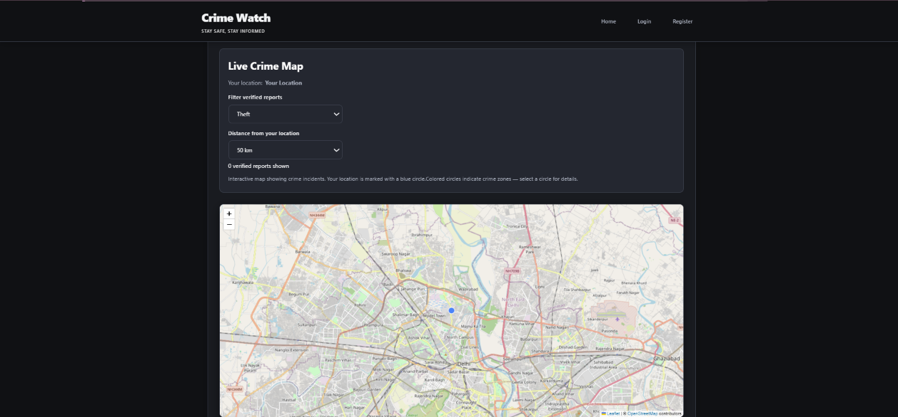
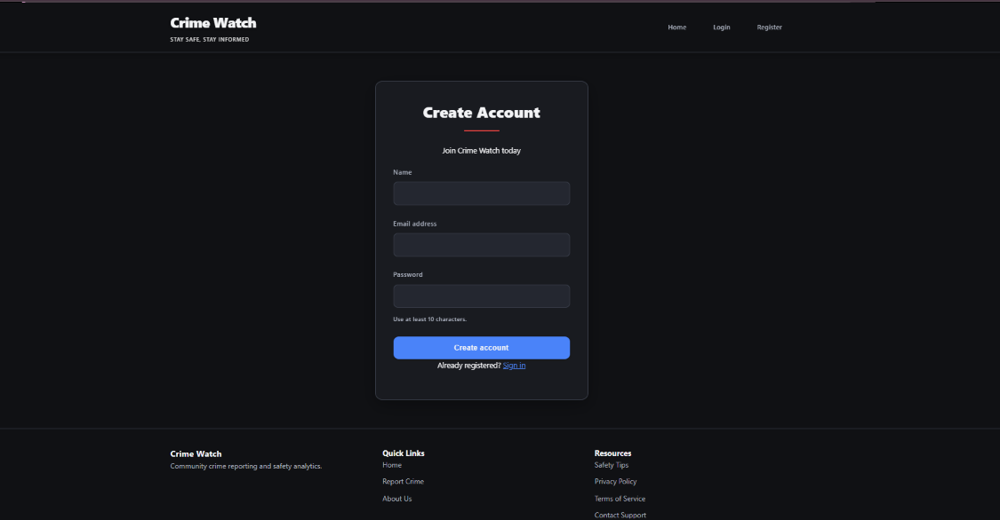
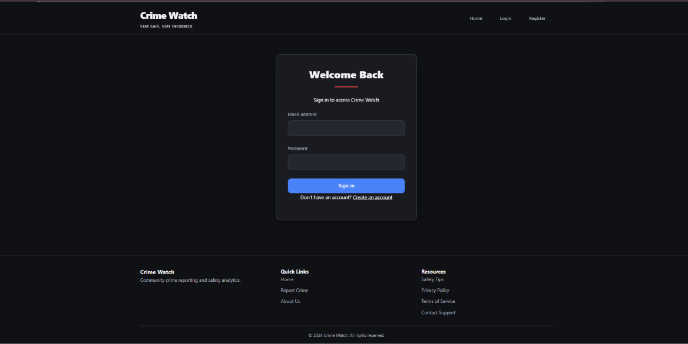
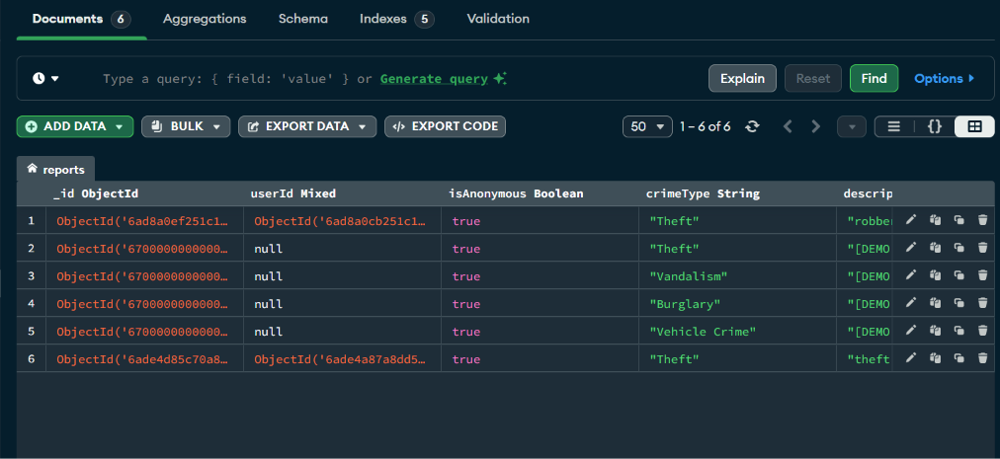
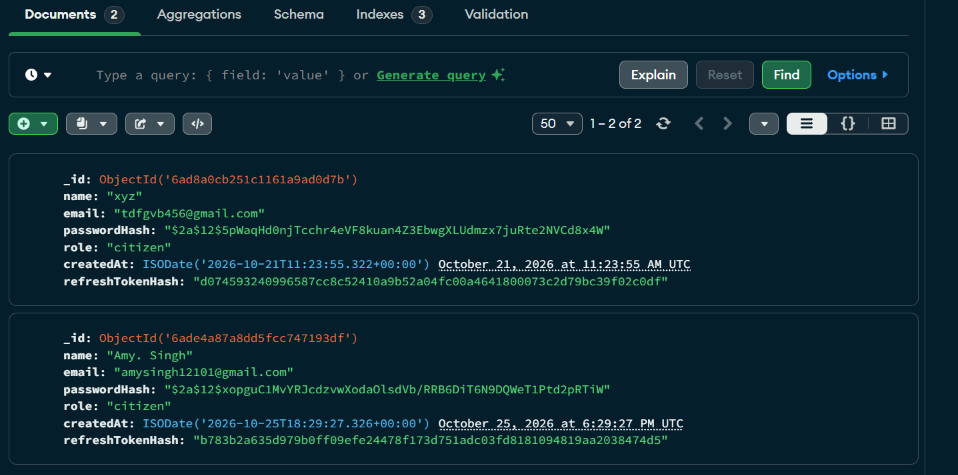
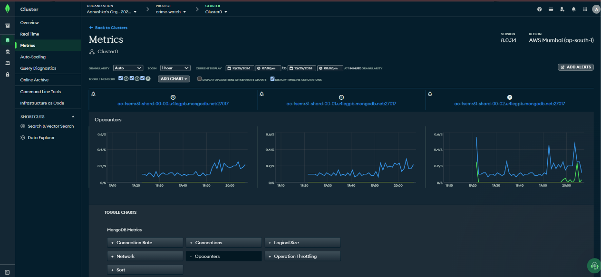

# Crime Watch

**Community Crime Reporting & Location-Based Safety Awareness**

Crime Watch is a full-stack web application for community crime reporting and location-based safety awareness. Built with React, Node.js, Express, and MongoDB, it allows users to submit crime reports, explore verified incidents on an interactive map, track report review outcomes, and view crime analytics.

**Live application:** [Crime Watch](https://crime-watch-8.onrender.com)  
**Backend API:** [Crime Watch API](https://crime-watch-7.onrender.com)  
**API health check:** [Check backend status](https://crime-watch-7.onrender.com/health)  
**Source code:** [GitHub Repository](https://github.com/Aanushka001/Crime-Watch)

> **Important:** Crime Watch is a demonstration project, not an official emergency-reporting service. Reports and map data should not be treated as verified real-world safety information unless independently confirmed.

## Features

- **User authentication:** Register and sign in with email and password, with optional Google sign-in.
- **Crime reporting:** Submit reports anonymously or while signed in, with optional browser-based location capture.
- **Interactive crime map:** Explore verified reports using Leaflet and OpenStreetMap.
- **Report history:** Track submitted reports and review outcomes after signing in.
- **Role-based access control:** Separate citizen, moderator, and administrator permissions.
- **Report moderation:** Review, verify, or reject reports according to user permissions.
- **Crime analytics:** Explore database-backed summaries of verified reports.
- **Geospatial queries:** Filter public reports by crime type and location.
- **Database inspection:** Use MongoDB Compass to inspect users, reports, and indexes.

## Live Demo

The frontend and backend are deployed separately on Render. The backend connects to MongoDB Atlas for persistent application data.

| Service | URL |
| --- | --- |
| Frontend | [crime-watch-8.onrender.com](https://crime-watch-8.onrender.com) |
| Backend | [crime-watch-7.onrender.com](https://crime-watch-7.onrender.com) |
| Health check | [Backend health endpoint](https://crime-watch-7.onrender.com/health) |

The application may take a short time to respond after inactivity on a free hosting tier.

## Screenshots

### Live Crime Map

Explore the interactive map and filter verified crime reports by type and distance.



### User Authentication

**Registration**



**Login**



### MongoDB Database

**Crime reports collection**



**Registered users collection**



### MongoDB Atlas Monitoring



*Database screenshots should be redacted before being published publicly. Remove email addresses, password hashes, refresh-token hashes, and any other sensitive information.*

## Technology Stack

| Layer | Technology | Purpose |
| --- | --- | --- |
| Frontend | React 18, Vite | User interface and production builds |
| Routing | React Router | Client-side navigation |
| Mapping | Leaflet, React Leaflet, OpenStreetMap | Interactive crime map |
| HTTP client | Axios | Frontend-to-backend API requests |
| Runtime | Node.js | Backend JavaScript runtime |
| Backend API | Express | Authentication, reporting, moderation, and analytics |
| Database | MongoDB | Persistent user and report data |
| ODM | Mongoose | Schemas, validation, and database queries |
| Authentication | JWT, HTTP-only refresh cookies | Access tokens and refresh sessions |
| Testing | Jest, Supertest | Backend API tests |

## Architecture

```text
React 18 + Vite
      |
      | HTTP / JSON API
      | JWT access token
      | HTTP-only refresh cookie
      v
Node.js + Express
      |
      | Mongoose models
      | Validation and authorization
      | Geospatial queries and aggregations
      v
MongoDB Community Server or MongoDB Atlas
      ^
      |
MongoDB Compass
(optional database inspection tool)
```

MongoDB Compass is a graphical database client, not a database server. Local development requires a running MongoDB Community Server instance; alternatively, configure the application to use MongoDB Atlas.

## Database Design

The application uses MongoDB collections to store application data.

- **`users`:** Account names, email addresses, password hashes, roles, creation timestamps, and authentication-related fields.
- **`reports`:** Crime types, descriptions, locations, timestamps, report statuses, anonymity settings, and user references.
- **Indexes:** Database indexes support common queries, including geospatial filtering and report lookups.

The actual database used by the application is determined by the `MONGODB_URI` environment variable. In production, configure it to use MongoDB Atlas. Never commit database credentials, JWT secrets, or other private environment variables.

## Getting Started

### Prerequisites

- Node.js 20 or newer and npm
- MongoDB Community Server or a MongoDB Atlas database
- MongoDB Compass (optional)

### 1. Clone the repository

```bash
git clone https://github.com/Aanushka001/Crime-Watch.git
cd Crime-Watch
```

### 2. Install backend dependencies

```bash
cd crime/server
npm install
```

Configure the server environment using the project's `.env.example` file or its setup command:

```bash
npm run setup
```

If the setup command is unavailable in your checked-out version, create `crime/server/.env` manually using `.env.example` as the template.

Configure the following values as applicable:

```dotenv
NODE_ENV=development
MONGODB_URI=your_mongodb_connection_string
JWT_ACCESS_SECRET=your_access_secret
JWT_REFRESH_SECRET=your_refresh_secret
```

Use two different, strong JWT secrets of at least 32 characters. Keep `.env` private and never commit it to GitHub.

### 3. Install frontend dependencies

Open a second terminal from the repository root:

```bash
cd crime/client
npm install
```

For optional Google sign-in, configure `GOOGLE_CLIENT_ID` on the server and `VITE_GOOGLE_CLIENT_ID` in the frontend environment. Email/password authentication does not require Google credentials.

### 4. Run the application locally

Start MongoDB first, then start the API.

**Terminal 1 — Backend**

```bash
cd crime/server
npm start
```

**Terminal 2 — Frontend**

```bash
cd crime/client
npm start
```

The default local addresses are:

- Frontend: `http://localhost:3000`
- Backend API: `http://localhost:5000`
- Backend health check: `http://localhost:5000/health`

These addresses assume the default ports configured by the project. If your environment uses different ports, follow the corresponding application configuration.

Mongoose connects to the database selected by `MONGODB_URI`. Collections and indexes are created or initialized according to the application's model and startup configuration.

## Optional Local Demo Data

The project includes an optional seed command for four fictional sample reports around Chennai. These records are intended for local screenshots and UI previews only.

Run the following command from `crime/server`:

```bash
npm run seed:demo
```

The seed operation is designed to create or refresh deterministic records marked `isDemo: true`. It should not modify user accounts or unrelated reports.

**Run this command only against a non-production local database.** Do not use fictional demo records to represent real crime incidents or public-safety information.

## Roles and Report Moderation

Crime Watch uses role-based access control:

- **Citizen:** Submit reports and view personal report history when signed in.
- **Moderator:** Review pending reports.
- **Administrator:** Access broader report review and administrative permissions.

Public self-registration creates citizen accounts. The API should not accept a role supplied by the registration client as authorization to create privileged accounts.

To grant administrator access for local development, register an account, connect to the correct database in MongoDB Compass, find the account by its exact email in the `users` collection, verify the account, and update only its `role` field to `administrator`. Sign out and sign back in afterward if the application loads the role into the access token.

Only grant administrative access to trusted accounts. Never share passwords or expose authentication tokens.

Signed-in users can track report review outcomes in their report history. Anonymous reports submitted while signed in may remain associated with the account for private history, while public responses should omit private reporter and reviewer identifiers. Reports submitted without signing in cannot be linked to an account's personal history.

Review updates are displayed in the application. Email notifications are not configured.

## API Overview

The backend exposes REST endpoints under `/api`.

| Method | Endpoint | Access | Purpose |
| --- | --- | --- | --- |
| `POST` | `/api/auth/register` | Public | Register a citizen account |
| `POST` | `/api/auth/login` | Public | Sign in with email and password |
| `POST` | `/api/auth/google` | Public; optional configuration | Verify Google sign-in |
| `POST` | `/api/auth/refresh` | Refresh cookie | Refresh an access session |
| `POST` | `/api/auth/logout` | Public | Revoke and clear the refresh session |
| `GET` | `/api/auth/profile` | Signed in | Retrieve the current profile |
| `POST` | `/api/reports` | Public; optional sign-in | Submit a crime report |
| `GET` | `/api/reports` | Signed in | Retrieve personal report history |
| `GET` | `/api/reports/public` | Public | Retrieve verified reports |
| `GET` | `/api/reports/moderation` | Moderator/admin | Retrieve reports for review |
| `PATCH` | `/api/reports/:id` | Owner/admin | Edit a permitted pending report |
| `DELETE` | `/api/reports/:id` | Owner/admin | Delete a permitted pending report |
| `PATCH` | `/api/reports/:id/moderate` | Moderator/admin | Verify or reject a report |
| `GET` | `/api/analytics` | Public | Retrieve verified-report analytics |

Protected endpoints use the `Authorization: Bearer <access-token>` header where required. Refresh sessions use an HTTP-only cookie.

## Testing and Verification

Run the backend tests and lint checks:

```bash
cd crime/server
npm test
npm run lint
```

Run the frontend checks:

```bash
cd crime/client
npm run lint
npm run build
```

Backend tests use mocks and do not necessarily require a running database. Verify actual database persistence separately using a configured MongoDB instance or Atlas connection.

## Security and Configuration

- Store secrets in environment variables, not in source control.
- Use HTTPS for deployed services.
- Keep access tokens and refresh sessions protected.
- Validate user input and enforce authorization on the server.
- Avoid exposing private account information in public API responses.
- Redact sensitive database fields in public screenshots.
- Treat demo records as fictional and never as real incident reports.

## License

Add a license file if you intend to distribute the project under a specific open-source license.